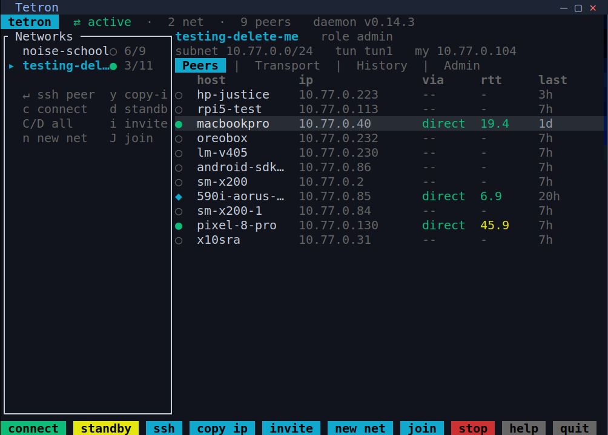

# tetron-tui

An interactive terminal UI for the [tetron](https://github.com/ErikAllanKincaid/tetron) P2P mesh VPN. Standalone, keyboard-first and mouse-capable, truecolor, and usable at the local console or over plain SSH, with or without a desktop. It talks to the local tetron daemon over its Unix control socket (`tetron-proto`), so it needs a running daemon on the same host.

<p align="center">
  
</p>

## What it shows and does

- Live network and peer status, auto-refreshed.
- **Peers**: per-peer connection, rtt, last-seen.
- **Transport**: conn type (direct/relay/tor/veilid), candidate paths with the why-not-direct reason, live MTU.
- **History**: btop-style braille charts of rtt and tx/rx throughput (rates derived from byte-counter deltas).
- **Admin**: key-holders, pending nuke proposals, and the admin actions.
- Actions: resume/standby (per network and global), create invite (shown as text + scannable QR), join by code, create network, stop/start the daemon, grant-admin, kick, nuke, leave.
- `Enter` on a connected peer opens an SSH session to its overlay IP; `y` or the toolbar button copies the selected peer's IP (OSC 52, works over SSH).

Press `?` in the app for the full key list. Clickable, colored action buttons are along the bottom.

## Install

The primary install path is a prebuilt binary from the [releases page](https://github.com/ErikAllanKincaid/tetron-tui/releases), which the tetron suite installer (`install-tetron-suite.sh`) places by default. Drop it on your `PATH` (e.g. `~/.local/bin/tetron-tui` or `/usr/local/bin/tetron-tui`) and run `tetron-tui`.

### Debian and Ubuntu (.deb)

Each release also carries `tetron-tui_<version>-1_<arch>.deb` for amd64 and arm64, with a `.sha256` file. Install with `sudo apt install ./tetron-tui_<version>-1_amd64.deb`. The package installs `/usr/bin/tetron-tui` and recommends the `tetron` daemon package for the same minor version (tetron-tui 0.14.x targets tetron 0.14), which is optional because the daemon can also come from a binary install. Use one method per host: a copy in `/usr/local/bin` (from the suite installer) comes first on `PATH` and would shadow the packaged binary, so remove it before installing the package. The package is built in release CI by [tetron-packaging](https://github.com/ErikAllanKincaid/tetron-packaging) from the same binary as the raw asset and tested in a clean `debian:trixie` container before upload.

## Build from source

```
cargo build --release
./target/release/tetron-tui
```

The first build is slow: `tetron-proto` pulls in the daemon's `iroh` dependency tree.

## Versioning

The version (and release tag) tracks tetron core's current **minor**, the same convention the other addons use: `tetron-tui 0.14.x` targets tetron `0.14`. `tetron-proto` is pinned to the matching core revision so the IPC wire format always matches the daemon. Matching the daemon's minor version is the rule of thumb for staying current.

## Releases / CI

Pushing a tag like `v0.14.0` triggers `.github/workflows/release.yml`, which builds Linux (x86_64, aarch64) and macOS (x86_64, aarch64) binaries and attaches them to a GitHub release. It can also be run manually from the Actions tab.

## License

MPL-2.0.
